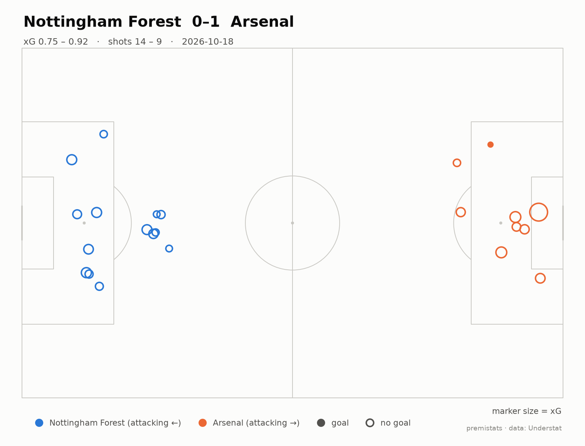
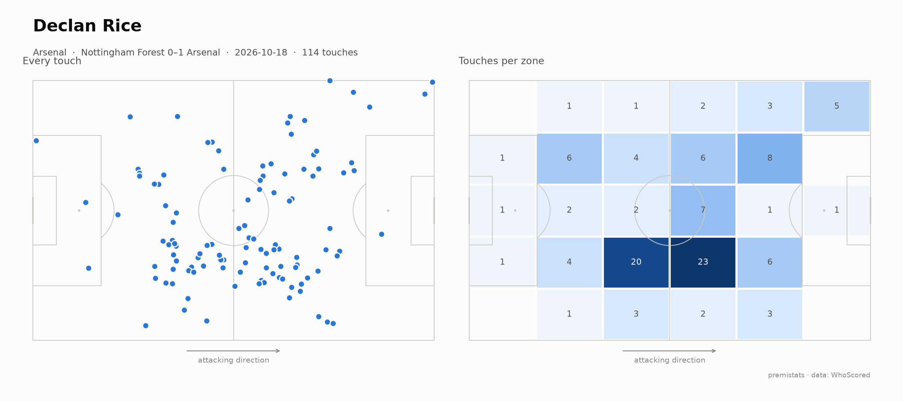

# premistats

Free, advanced Premier League stats and visualisations: shot maps, heatmaps, xG, pass networks and a build-your-own chart tool. Focused on the 2026/27 season.

> 🚧 Early development. Currently: the ingestion pipeline and prototype charts.





## How it works

```
scrapers (soccerdata) → data/raw (immutable JSON per match)
   → bronze Parquet (schema checks) → dbt models (silver → gold)
   → exported aggregates → static website (Next.js + DuckDB-WASM)
```

Design choices and trade-offs are logged in [docs/decisions.md](docs/decisions.md). Every stat's exact definition is in [docs/metrics.md](docs/metrics.md).

**Data quality:** bronze tables are validated with pandera (types, ranges, uniqueness), and every `dbt build` runs data tests, e.g. player goals + own goals must equal each final score, and each team's minutes must add up to 11 × match length after red cards.

## Running it locally

Requires Python 3.12 and Google Chrome (WhoScored is read through a headless browser).

```bash
py -3.12 -m venv .venv
.venv\Scripts\activate
pip install -r requirements.txt

python -m pipeline.run                       # full refresh: ingest -> bronze -> dbt build (+ tests)
python -m pipeline.run --skip-ingest         # rebuild tables from data already saved
python -m analysis.shot_map                  # shot map for the latest saved match
python -m analysis.player_touches            # touch map + heatmap (busiest player, latest match)
python -m analysis.player_touches data/raw/whoscored/2627/<match_id>.json.gz "Declan Rice"
```

## Data & attribution

Data is collected from public match centres (Understat for shots and xG, WhoScored for event data). Raw scraped data is never republished. The site shows only derived statistics, our own model outputs and charts. If you're a rights holder with concerns, please open an issue.

**xG model:** trained on [StatsBomb open data](https://github.com/statsbomb/open-data) under the StatsBomb Public Data User Agreement (research use, non-commercial, attribution). See [docs/xg_model.md](docs/xg_model.md) for the model card and validation results.


