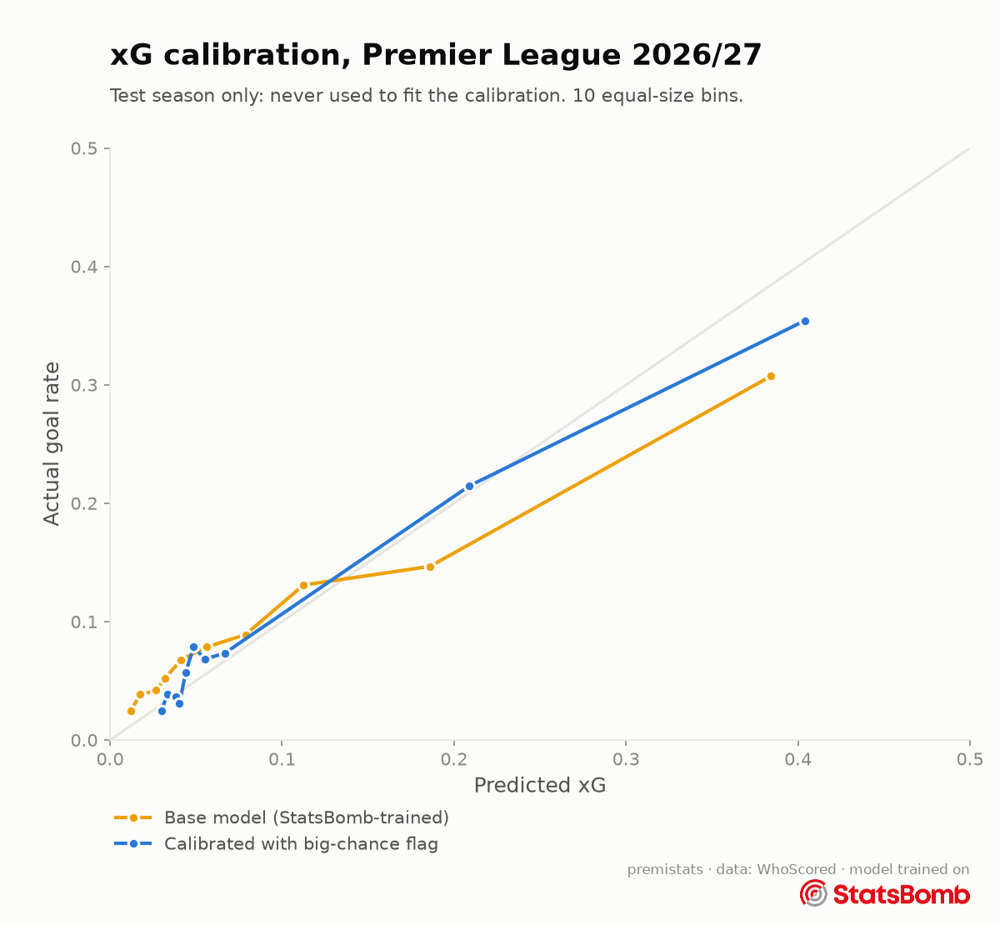

# xG stage 2: Premier League calibration

*Generated by `python -m xg.calibrate` on 21 Oct 2026. Do not edit by hand.*

The base model ([xg_model.md](xg_model.md)) can't see where defenders and the goalkeeper are, so it under-rates big chances and over-rates other shots (decision 021). Stage 2 corrects this with WhoScored's big-chance flag:

`xG = sigmoid(a + b·logit(base xG) + c·big_chance + d·big_chance·logit(base xG))`

- **Fitted on:** Premier League 2025/26 (9,411 non-penalty shots)
- **Tested on:** Premier League 2026/27, a different season, never used for fitting
- **Coefficients:** a = -2.112, b = 0.311, c = 1.993, d = 0.132

## Results on 2026/27 (non-penalty shots)

| | Log loss | Brier | ROC AUC | Sum of xG | Goals |
|---|---|---|---|---|---|
| Base model | 0.2954 | 0.0824 | 0.721 | 181.4 | 187 |
| Calibrated (stage 2) | 0.2736 | 0.0773 | 0.759 | 185.6 | 187 |

### By shot type

| | Shots | Goals | Base xG | Calibrated xG |
|---|---|---|---|---|
| Big chances | 339 | 107 | 83.5 | 113.6 |
| Other shots | 1,574 | 80 | 97.9 | 72.0 |

Data: WhoScored (shots, big-chance flag). Base model trained on StatsBomb open data.

