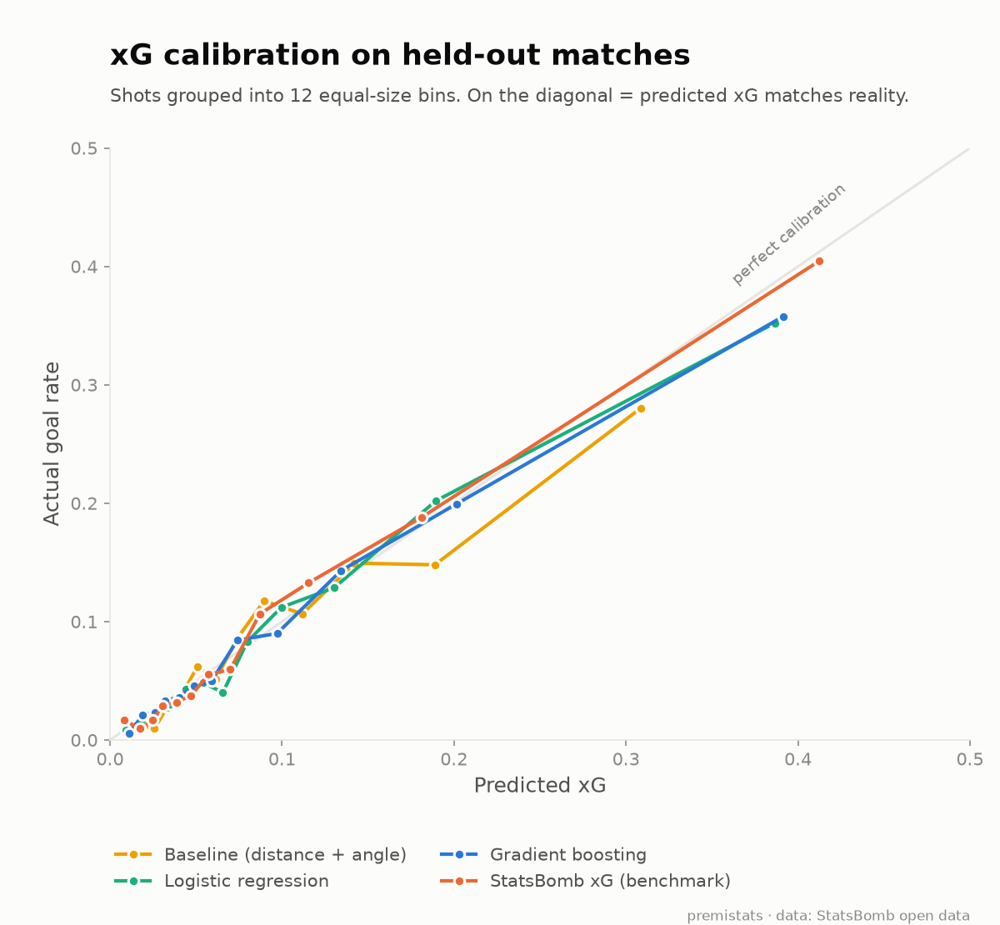
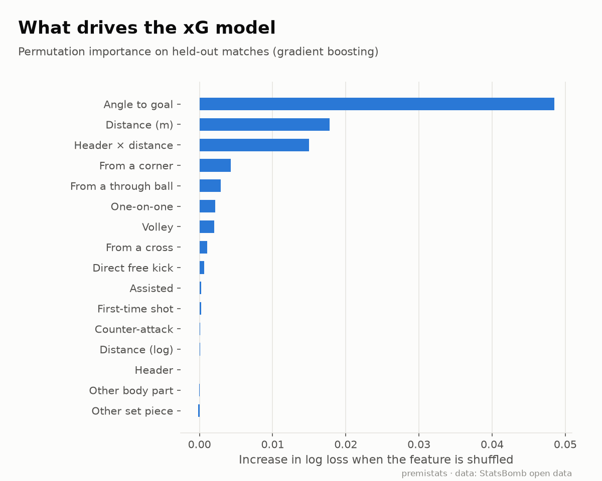

# premistats xG model card

*Generated by `python -m xg.train` on 21 Oct 2026. Do not edit by hand.*

## What it is
Expected goals (xG) is the probability that a shot becomes a goal, based on where it was taken and how. premistats trains its own model on StatsBomb open data and applies it to every 2026/27 Premier League shot recorded by WhoScored.

## Training data
- **43,094 non-penalty shots** from **1,747 matches**: four complete 2015/16 top-flight seasons (England, Spain, Italy, France), World Cups 2018 and 2022, and Euros 2020 and 2024. One-club samples are excluded (decision 017).
- Split **by match** (80/20): 34,416 training shots, 8,678 test shots. Shots from the same match never appear on both sides, which keeps match-level patterns from leaking into the test set.
- **Penalties** are left out of the model and get a fixed xG of **0.73**, the penalty conversion rate in the training data.

## Features
Only features both StatsBomb and WhoScored record, mapped to one shared vocabulary (`xg/features.py`): distance and goal angle, body part, situation (open play, counter, corner, other set piece, direct free kick), first-time, one-on-one, volley, and whether the shot was assisted, from a cross or from a through ball.

## Results on held-out matches
Lower log loss and Brier score are better; higher ROC AUC is better.

| Model | Log loss | Brier | ROC AUC | Mean xG | Goal rate |
|---|---|---|---|---|---|
| Baseline (distance + angle) | 0.2727 | 0.0764 | 0.739 | 0.095 | 0.091 |
| Logistic regression | 0.2561 | 0.0722 | 0.787 | 0.095 | 0.091 |
| Gradient boosting | 0.2543 | 0.0719 | 0.789 | 0.094 | 0.091 |
| StatsBomb xG (benchmark) | 0.2445 | 0.0687 | 0.808 | 0.091 | 0.091 |

**Chosen model: Gradient boosting** (lowest log loss of our models).

StatsBomb's own xG also uses information we can't (defender and goalkeeper positions at the moment of the shot), so it is an upper benchmark rather than a like-for-like competitor.

### By competition (chosen model, test set)

| Competition | Shots | Goals | Sum of xG | Log loss |
|---|---|---|---|---|
| Euro 2020 | 311 | 29 | 29.8 | 0.2849 |
| Euro 2024 | 348 | 24 | 32.1 | 0.2240 |
| La Liga 2015/16 | 1,613 | 162 | 167.1 | 0.2669 |
| Ligue 1 2015/16 | 1,762 | 164 | 156.2 | 0.2577 |
| Premier League 2015/16 | 1,932 | 170 | 194.5 | 0.2566 |
| Serie A 2015/16 | 2,152 | 169 | 185.5 | 0.2253 |
| World Cup 2018 | 279 | 30 | 27.6 | 0.2939 |
| World Cup 2022 | 281 | 39 | 27.1 | 0.3323 |

## Known limitations
- No defender or goalkeeper positions (WhoScored doesn't publish them), so a shot through a crowd and an open-goal tap-in from the same spot get similar xG.
- Training data is mostly 2015/16; finishing and shot selection have shifted slightly since.
- Situation labels come from two providers with slightly different definitions (decision 018).

Data: StatsBomb open data, used under the StatsBomb Public Data User Agreement.
